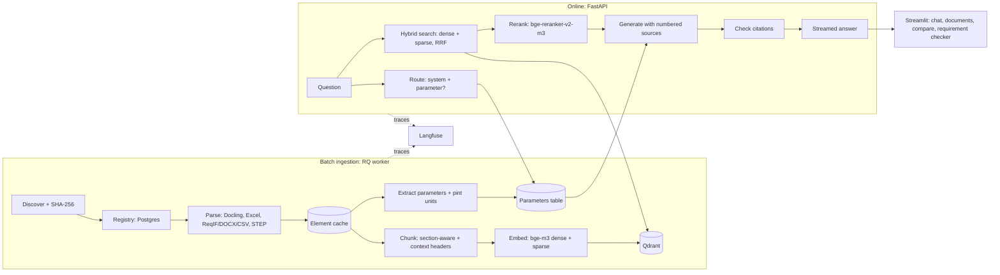

# FuelCell-RAG

Retrieval-augmented question answering over fuel cell engineering documents: datasheets, parameter
sheets, requirement specifications, STEP assemblies and public technical reports, in German and
English. Every claim in an answer cites a page, table cell, requirement ID or CAD part.

All data is public or synthetic. Three **fictional** PEM fuel cell systems are defined once in
YAML ([`data_gen/systems/`](data_gen/systems/)); generators turn them into documents and record
where each value appears, which gives exact gold labels for evaluation.

| System | Application | Rated net power |
|---|---|---|
| A | Passenger car | 80 kW |
| B | Heavy-duty truck | 2 × 150 kW |
| C | Stationary CHP | 100 kW |

## Results

Measured on the 60-question golden set (21 German) and the 51-document corpus
(33 public PDFs and 18 generated files, about 5,000 chunks).

| Metric | Result | Target |
|---|---|---|
| Retrieval recall@5 | **0.962** | ≥ 0.85 |
| Retrieval recall@10 / MRR | 0.981 / 0.884 | – |
| Parameter extraction, recall / precision (610 facts, Docling included) | **99.5 % / 99.5 %** | ≥ 85 % |
| Unanswerable questions refused at retrieval level / false refusals | 0.857 / 0.0 | ≥ 0.90 (answer level) |
| Ingestion throughput (laptop RTX 3050, 6 GB) | ~1,150 PDF pages/h | ≥ 1,000 |
| Retrieval latency p50 / p95 (embed, hybrid search, rerank 50) | 1.5 s / 2.8 s | end-to-end p95 < 6 s |
| Answer metrics (faithfulness, value accuracy, citation precision) | pending | see below |

Recall per category: parameter, cross-system, version conflict, requirement trace and
drawing/STEP 1.00; public-document facts 0.92; cross-document 0.88.

Answer-level metrics need an LLM. Set `ANTHROPIC_API_KEY` (or run a local model through
Ollama) and run `fcrag eval --answers`. Latency was measured with the GPU otherwise idle; under
a busy GPU (games, other ML jobs) the reranker slows down several-fold.

## Architecture



- **Parsing.** Docling for PDF layout, reading order, headings and tables (one fact per table
  row). openpyxl for messy Excel: merged cells, multi-row headers, several tables per sheet,
  units rows, hidden rows. ReqIF/DOCX/CSV requirements with parent and prose links. STEP
  assembly trees with bounding boxes and volumes.
- **Parameters.** Table rows and sentences become records (system, component, key, value,
  unit, condition, source), normalised with pint. Questions naming a system and a parameter
  get these records as exact, citable sources.
- **Retrieval.** bge-m3 dense and sparse vectors in Qdrant, fused by reciprocal rank fusion,
  reranked by a multilingual cross-encoder. A calibrated threshold answers "not found" instead
  of guessing.
- **Generation.** LiteLLM: any hosted model, or a local model in restricted mode so no
  document text leaves the machine. Versioned prompt, streamed answer, citation check.

Design decisions: [`docs/decisions/`](docs/decisions/).

## Quick start

Requirements: Python 3.12, [uv](https://docs.astral.sh/uv/), Docker. A CUDA GPU helps; CPU works.

```bash
uv sync --all-extras          # ml (torch, Docling, FlagEmbedding), ui, cad
cp .env.example .env          # replace every CHANGEME; add ANTHROPIC_API_KEY for answers
docker compose up -d          # Qdrant, Postgres, Redis, MinIO, Langfuse
uv run fcrag db-upgrade       # create the tables

uv run python scripts/download_corpus.py   # 33 public PDFs, licences in data/sources.yaml
uv run fcrag generate         # synthetic datasheets, parameter sheets, requirements, STEP
uv run fcrag ingest           # parse, extract, chunk, embed, index (new or changed files only)

uv run fcrag search "maximum coolant outlet temperature of System B"
uv run fcrag ask "Welche Auslegungslebensdauer gilt aktuell für System B?"
uv run fcrag serve            # API on :8000, docs at /docs
uv run streamlit run src/fcrag/ui/chat.py   # UI on :8501
```

Everything in containers, the app included: `docker compose --profile app up -d --build`.

| Command | Purpose |
|---|---|
| `fcrag eval [--answers] [--gate eval/gate.yaml]` | Run the golden set, save to `eval/runs/` |
| `fcrag eval-report` | All saved runs as one Markdown comparison table |
| `fcrag eval-params` | Extracted parameters vs generator facts |
| `fcrag golden` | Rebuild the golden set from the truths |
| `fcrag worker` | Background ingestion worker (Redis queue) |

## Applications

- **Chat**: streamed answers, sources with page preview, version labels (latest or
  superseded), copy with citations, rating and comment linked to the Langfuse trace.
- **Documents**: registry with status, counts, errors, quarantine and a re-ingest button.
- **Parameter comparison**: values per system from the parameters table; disagreements
  between current documents are flagged.
- **Requirement checker**: paste a draft requirement; stated values are checked against the
  current documents, and similar and linked requirements are listed.

## Evaluation

The golden set ([`eval/golden_set.jsonl`](eval/golden_set.jsonl)) covers 8 categories:

| Category | Questions | Built from |
|---|---|---|
| Fact from public text | 12 | hand-written, answers checked against the PDFs |
| Parameter lookup | 12 | truth + generator facts |
| Cross-system comparison | 6 | truth |
| Version conflict | 3 | superseded values in the truth |
| Requirement trace | 6 | generated requirement trees |
| Cross-document | 8 | requirements vs parameter sheets, incl. deliberate contradictions |
| Drawing / STEP | 6 | STEP assemblies and BOM sheets |
| Unanswerable | 7 | hand-written |

Gold sources are recorded by the generators while they write each document, so they stay
exact when documents are regenerated; a unit test fails if the committed set drifts from the
truth. Each run stores its configuration, so runs can be compared one variable at a time
(`fcrag eval-report`). CI runs the [evaluation gate](.github/workflows/eval.yml) on every pull
request.

## Lessons learned

- **A full GPU slows down instead of failing.** On Windows, parsing and embedding models
  sharing a 6 GB card spilled into system memory and ran 10× slower. Two-phase ingestion
  (parse everything, release the parser, then embed) fixed it ([ADR 0003](docs/decisions/0003-two-phase-ingestion.md)).
- **Native libraries can clash.** OpenCascade (STEP) and docling-parse cannot load into one
  Windows process; STEP geometry now runs in a child process.
- **A threshold cannot catch near-synonyms.** "Warranty period" scores 0.64 against "design
  lifetime: 8,000 h". The not-found threshold handles 6 of 7 unanswerable questions; the last
  one depends on the prompt.
- **Check misses before tuning.** Half the STEP "misses" were BOM rows that really answered
  the question; the gold labels were incomplete, not the retrieval.
- **Cross-lingual retrieval is the weakest spot.** A German question about an English slide
  deck ranks German requirement documents first. Query translation is the next experiment.

## Repository layout

```
src/fcrag/
  ingest/        discover, parsers/ (pdf, excel, requirements, step), chunking, extraction,
                 embedding cache, pipeline, worker
  retrieval/     hybrid search, rerank, parameter routing
  generation/    answer service, prompts, citation checks
  apps/          parameter comparison, requirement checker
  api/ ui/       FastAPI service, Streamlit pages
  datagen/       synthetic corpus generators
  eval/          golden set, metrics, runner, gate, report
data_gen/        system truths and synonyms
data/sources.yaml  public corpus manifest with licences (PDFs are never committed)
eval/            golden set, CI gate thresholds, run records (git-ignored)
prompts/         versioned prompts
docs/decisions/  architecture decision records
```

## Licence

Code: MIT. Public documents keep their own licences (see `data/sources.yaml`) and are not
redistributed. All system data is fictional.
