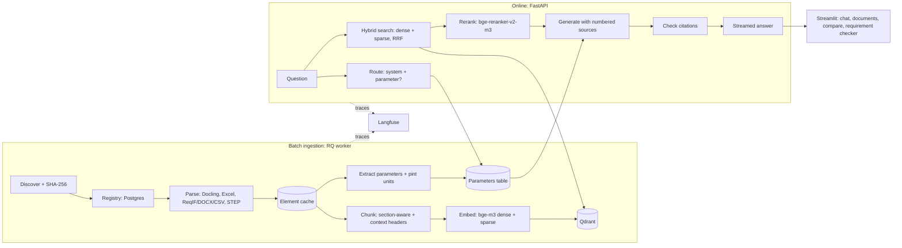

# FuelCell-RAG

Retrieval-augmented question answering over fuel cell engineering documents: datasheets, parameter
sheets, requirement specifications, STEP assemblies and public technical reports, in German and
English. Every claim in an answer cites a page, table cell, requirement ID or CAD part.

All data is public or synthetic. Three **fictional** PEM fuel cell systems are defined once in
YAML ([`data_gen/systems/`](data_gen/systems/)); generators turn them into documents and record
where each value appears, which gives exact gold labels for evaluation.

| System | Application | Rated net power |
|---|---|---|
| A | Passenger car | 80 kW |
| B | Heavy-duty truck | 2 × 150 kW |
| C | Stationary CHP | 100 kW |

## Results

Measured on the 67-question golden set (24 German) and the 80-document corpus (33 public
PDFs and 47 generated files: datasheets, component datasheets, parameter sheets,
requirements, schematics and STEP assemblies), run of 2026-10-30. Answers by
`openai/gpt-oss-120b` on Groq's free tier (58 answers; 2 from the Gemini fallback, 1 error).
Rows marked † come from the earlier 60-question run and were not re-measured.

| Metric | Result | Target |
|---|---|---|
| Retrieval recall@5 / recall@10 / MRR | **0.917** / 0.950 / 0.847 | ≥ 0.85 |
| Value accuracy (stated value and unit match the truth, any unit) | **0.946** | ≥ 0.85 |
| Term accuracy (requirement IDs, part and drawing tags named in the answer) | **1.00** | – |
| Correct "not in the documents" answers / false refusals | **7 of 7** / 1 of 59 | ≥ 0.90 |
| Citation precision (cited source is a gold source) | **0.941** | ≥ 0.90 |
| Faithfulness, 67 claims (judge / second-opinion labels) † | 0.931 / **0.877** | ≥ 0.90 |
| Invalid citations (source numbers that do not exist) | 0 | 0 |
| Parameter extraction recall / precision (610 facts, through Docling) † | **99.5 % / 99.5 %** | – |
| Ingestion throughput (laptop RTX 3050, 6 GB) † | ~1,150 PDF pages/h | ≥ 1,000 |
| Retrieval p50 / p95 · generation p95 | 2.1 s / 2.9 s · 4.8 s † | end-to-end p95 < 6 s |

Generation p95 in this run was 23.8 s, but that includes waiting out Groq's free-tier limit of
8,000 tokens per minute; the 4.8 s comes from the earlier run without rate limiting.

Recall per category: parameter, cross-system, version conflict, requirement trace and
drawing/STEP 1.00; public-document facts 0.92; cross-document 0.50 (0.63 before the
component datasheets were added). Cross-document is measured strictly: a conflict question
only counts as found when the conflicting requirement is retrieved, which plain ranking
often misses. The answer pipeline adds the best requirement chunks to such questions.

Where it still fails (all visible in `eval/runs/`): a German question about an English slide
deck (text-11) is refused because the German requirement documents outrank the English deck;
a three-system comparison picks up an unrelated current-density value from a public report.

How the answers are judged: `qwen/qwen3.8-27b` (a different model family from the answering
`openai/gpt-oss-120b`) checks every cited sentence against the sources it cites. Its verdicts
are exported, and `fcrag judge-label` walks a person through a random sample of 50 with the
judge's verdict hidden; `fcrag judge-agreement` then reports how often judge and human agree.
The faithfulness figure should be read together with that agreement rate.

Calibration so far: a second LLM (Claude, a third model family) labelled all 67 claims without
seeing the judge's verdicts, using the same strict standard: every fact in a claim must be in
the sources *that claim cites*. The judge agreed on 63 of 67 (94 %) and was never stricter; it
passed 4 claims whose cited sources lack part of the claim (a superlative needing a source
that was not cited, a "latest value" backed only by superseded documents, part descriptions
missing from the cited STEP tree). With those corrected, faithfulness is **0.877**, slightly
under the 0.90 target, so the judged 0.931 is an upper bound. These are LLM labels, not human
ones; a person's labels (`fcrag judge-label`) remain the reference.

Answer metrics can be recomputed from a saved run without any LLM call
(`fcrag eval-rescore`), so metric fixes cost no API quota. Free tiers allow roughly one full
answer evaluation per day (Groq caps tokens per day), so reruns are paced
(`fcrag eval --pause`). Prompt v3, which asks the model to name requirement IDs, raised ID
accuracy on requirement questions from 0.86 to 1.00 (14 questions); the headline numbers above
are from the full run with prompt v2. Latency was measured with the GPU otherwise idle; under a
busy GPU (games, other ML jobs) the reranker slows down several-fold.

## Architecture



- **Parsing.** Docling for PDF layout, reading order, headings and tables (one fact per table
  row). openpyxl for messy Excel: merged cells, multi-row headers, several tables per sheet,
  units rows, hidden rows. ReqIF/DOCX/CSV requirements with parent and prose links. STEP
  assembly trees with bounding boxes and volumes. Drawings (PDF or image): the text layer, or
  RapidOCR for scans, read by position into components, line list, revision history and title
  block; an optional vision model adds a description marked as low confidence.
- **Parameters.** Table rows and sentences become records (system, component, key, value,
  unit, condition, source), normalised with pint. Questions naming a system and a parameter
  get these records as exact, citable sources.
- **Retrieval.** bge-m3 dense and sparse vectors in Qdrant, fused by reciprocal rank fusion,
  reranked by a multilingual cross-encoder. A calibrated threshold answers "not found" instead
  of guessing.
- **Generation.** LiteLLM: any hosted model, or a local model in restricted mode so no
  document text leaves the machine. Versioned prompt, streamed answer, citation check.
- **Conversations.** A follow-up ("and for System C?") is rewritten into a standalone question
  from the earlier turns before retrieval; if the rewrite fails, the question is used as asked.
  Questions that name a system only retrieve that system's documents and the public reports.

Design decisions: [`docs/decisions/`](docs/decisions/).

## Quick start

Requirements: Python 3.12, [uv](https://docs.astral.sh/uv/), Docker. A CUDA GPU helps; CPU works.

```bash
uv sync --all-extras          # ml (torch, Docling, FlagEmbedding), ui, cad
cp .env.example .env          # replace every CHANGEME; add a free GROQ_API_KEY for answers
docker compose up -d          # Qdrant, Postgres, Redis, MinIO, Langfuse
uv run fcrag db-upgrade       # create the tables

uv run python scripts/download_corpus.py   # 33 public PDFs, licences in data/sources.yaml
uv run fcrag generate         # system and component datasheets, parameter sheets, requirements, schematics, STEP
uv run fcrag ingest           # parse, extract, chunk, embed, index (new or changed files only)

uv run fcrag search "maximum coolant outlet temperature of System B"
uv run fcrag ask "Welche Auslegungslebensdauer gilt aktuell für System B?"
uv run fcrag serve            # API on :8000, docs at /docs
uv run streamlit run src/fcrag/ui/chat.py   # UI on :8501
```

Everything in containers, the app included: `docker compose --profile app up -d --build`.

| Command | Purpose |
|---|---|
| `fcrag eval [--answers] [--gate eval/gate.yaml]` | Run the golden set, save to `eval/runs/` |
| `fcrag eval-report` | All saved runs as one Markdown comparison table |
| `fcrag eval-params` | Extracted parameters vs generator facts |
| `fcrag golden` | Rebuild the golden set from the truths |
| `fcrag worker` | Background ingestion worker (Redis queue) |

## Applications

- **Chat**: streamed answers, follow-up questions (the rewritten question is shown), sources
  with page preview, version labels (latest or superseded), copy with citations, rating and
  comment linked to the Langfuse trace.
- **Documents**: registry with status, counts, errors, quarantine and a re-ingest button.
- **Parameter comparison**: values per system from the parameters table; disagreements
  between current documents are flagged.
- **Requirement checker**: paste a draft requirement; stated values are checked against the
  current documents, and similar and linked requirements are listed.

## Evaluation

The golden set ([`eval/golden_set.jsonl`](eval/golden_set.jsonl)) covers 8 categories:

| Category | Questions | Built from |
|---|---|---|
| Fact from public text | 12 | hand-written, answers checked against the PDFs |
| Parameter lookup | 12 | truth + generator facts |
| Cross-system comparison | 6 | truth |
| Version conflict | 3 | superseded values in the truth |
| Requirement trace | 6 | generated requirement trees |
| Cross-document | 8 | requirements vs parameter sheets, incl. deliberate contradictions |
| Drawing / STEP | 13 | STEP assemblies, BOM sheets, system and subsystem schematics (title block, revisions, line list) |
| Unanswerable | 7 | hand-written |

Gold sources are recorded by the generators while they write each document, so they stay
exact when documents are regenerated; a unit test fails if the committed set drifts from the
truth. Each run stores its configuration, so runs can be compared one variable at a time
(`fcrag eval-report`). CI runs the [evaluation gate](.github/workflows/eval.yml) on every pull
request.

## Lessons learned

- **A full GPU slows down instead of failing.** On Windows, parsing and embedding models
  sharing a 6 GB card spilled into system memory and ran 10× slower. Two-phase ingestion
  (parse everything, release the parser, then embed) fixed it ([ADR 0003](docs/decisions/0003-two-phase-ingestion.md)).
- **Native libraries can clash.** OpenCascade (STEP) and docling-parse cannot load into one
  Windows process; STEP geometry now runs in a child process.
- **A threshold cannot catch near-synonyms.** "Warranty period" scores 0.64 against "design
  lifetime: 8,000 h". The not-found threshold handles 6 of 7 unanswerable questions; the last
  one depends on the prompt.
- **Check misses before tuning.** Half the STEP "misses" were BOM rows that really answered
  the question; the gold labels were incomplete, not the retrieval.
- **Cross-lingual retrieval is the weakest spot.** A German question about an English slide
  deck ranks German requirement documents first. Query translation is the next experiment.
- **Evaluate the evaluation.** The first answer run reported term accuracy 0.26: gpt-oss writes
  non-breaking hyphens (REQ‑A‑0013) and citations like 【S2†L1-L3】. After normalising both,
  0.91. A judge that sees truncated sources reports hallucinations that are not there.
- **Score the scorer.** "Four tie rods" failed a value check that only read digits, and a
  correct answer was counted as a refusal because a later sentence said a table "does not
  contain" a row. Both fixed and re-scored offline from the stored answers.
- **A good answer can hide a retrieval gap.** "Does the requirement agree with the sheet?"
  retrieved only the sheet, and the model said "yes" about a requirement it never saw.

## Repository layout

```
src/fcrag/
  ingest/        discover, parsers/ (pdf, excel, requirements, step, drawing), chunking, extraction,
                 embedding cache, pipeline, worker
  retrieval/     hybrid search, rerank, parameter routing
  generation/    answer service, prompts, citation checks
  apps/          parameter comparison, requirement checker
  api/ ui/       FastAPI service, Streamlit pages
  datagen/       synthetic corpus generators
  eval/          golden set, metrics, runner, gate, report
data_gen/        system truths and synonyms
data/sources.yaml  public corpus manifest with licences (PDFs are never committed)
eval/            golden set, CI gate thresholds, run records (git-ignored)
prompts/         versioned prompts
docs/decisions/  architecture decision records
```

## Licence

Code: MIT. Public documents keep their own licences (see `data/sources.yaml`) and are not
redistributed. All system data is fictional.
